# Changing the finish of a real house without moving its geometry

**A small, honest benchmark of three ComfyUI workflows that re-finish a photographed house.**

One input photo of a house that is actually being built. Three image models, three different ways of
holding the building still. Two metrics written for the two different failure modes — *did the geometry
survive*, and *did the finish actually change* — and one finding that matters more than the ranking:
**the metric I wrote first is blind to the part of the task the task is about.**

Status: three working graphs, one measured run per method (nine geometry rows, four appearance rows),
one cost record per headless run, gallery with full provenance. Not done: the façade region, three
seeds per method, cold cost runs. Details in [docs/metrics.md § 3–4](docs/metrics.md).

---

## 1. The question

We are building a house. I have an aerial photo of the shell and no design project. The practical
question is the same one an archviz product has to answer:

> can a generative model put a different façade finish on **this** building — the same volume, the same
> roofline, the same window openings in the same centimetres — and can I tell, without eyeballing it,
> whether it cheated?

That is a comparison task, not a demo, so it needs the two halves a comparison needs: more than one way
to solve it, and numbers that say what each one broke.

## 2. What was compared

All three graphs take the same single image (`DJI_0021`, aerial, 2048×1152 in the repo copy) and the
same seed `20261103`. They differ in **what they condition on**:

| # | graph | base model | what constrains the edit | steps / cfg | reproducible? |
|---|---|---|---|---|---|
| **A** | [`workflows/krea2_edit.json`](workflows/krea2_edit.json) | Krea 2 (`kreavantisMASTERFP8_v10` fp8 UNet) + `krea2_identity_edit_v1_2` LoRA | **nothing spatial** — the whole image goes into an image-edit; the prompt asks to keep the building and change only the finishes | 10 / 1.0, `euler_ancestral` | ❌ same seed, different picture (run-to-run distance 0.0045 in the appearance metric) |
| **B** | [`workflows/moss_inpaint.json`](workflows/moss_inpaint.json) | MOSS Image SFT (`moss_image_sft_bf16`) + `moss-color-depth-control` control weights | **depth + colour control signal + layout boxes** — `LCMOSSBoxEdit` edits only inside a drawn box, grow 16 / feather 64, depth from `DepthAnythingV2Preprocessor` | 25 / 2.5, `er_sde` / `simple` | ✅ replays of the frozen graph are byte-identical files |
| **C** | [`workflows/qwenImage_inpaint.json`](workflows/qwenImage_inpaint.json) | Qwen-Image 2.1 (`qwenImage21_bf16`, `qwen3vl_8b` text encoder, `sam3.1` for the mask) | **an inpaint mask** touched in the UI + the result stitched back: everything outside the mask is copied pixel-for-pixel | cfg 1.0, `euler` / `simple` | ⚠️ the region is reproducible, but the graph cannot be replayed headless at all — the touched points live in the browser |

Each graph also saves the **depth map of its own input and of its own result** — that is what makes the
comparison measurable instead of decorative (see `docs/gallery/depth/`).

The prompts are *not* unified, and that is a limitation, not a design: A and C were told which finish to
make ("light warm-grey plaster, dark graphite window frames, dark standing-seam metal roof"), B was only
told "apply modern façade finishing materials" with a material list attached — so B freely chose, and it
also changed the window surrounds.

## 3. What came out

The same frame, three methods, one shared request as far as it can be shared:

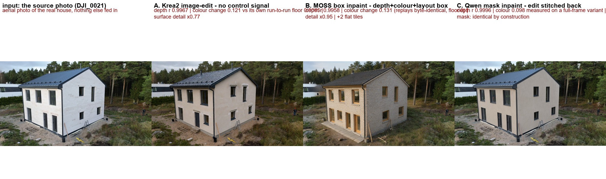

<sub>A and C did what they were told; B invented a finish (it was not told which). All three kept the
house. What the numbers say about "kept" is § 4.</sub>

### A — Krea2 image-edit, no spatial control

| | | |
|---|---|---|
| 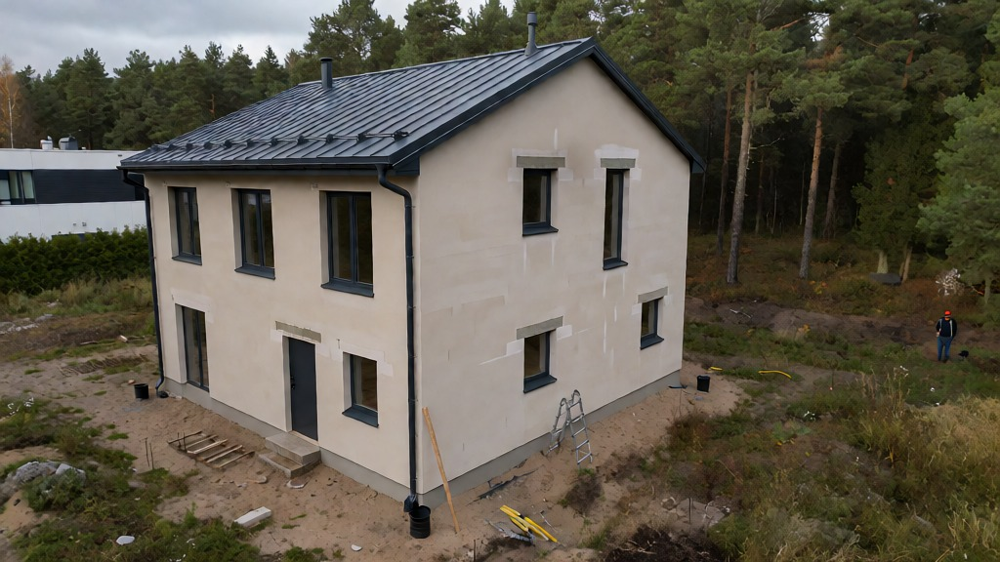 |  | 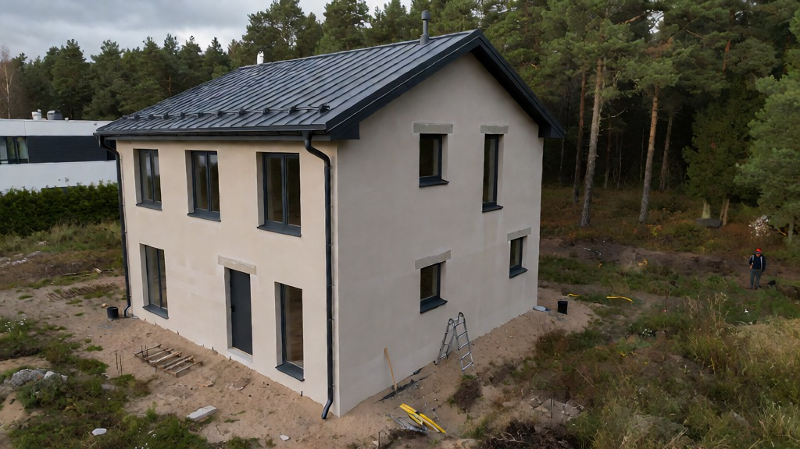 |
| pair 00004 · **r 0.9967** | pair 00003 · r 0.9913 | pair 00002 · **r 0.3326** — the house was redrawn from another place |

Same prompt, same seed, three different outcomes — including one run where the whole geometry collapsed.
Two other requests through the same graph, no control at all:

| three materials named in the prompt | finish not named, the model chose | 31.10 test, another frame: the "it became a CGI render" failure |
|---|---|---|
| 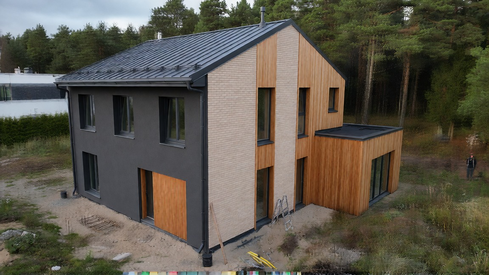 | 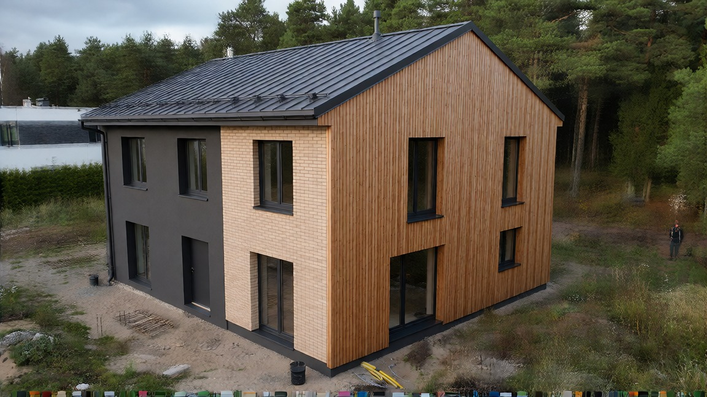 | 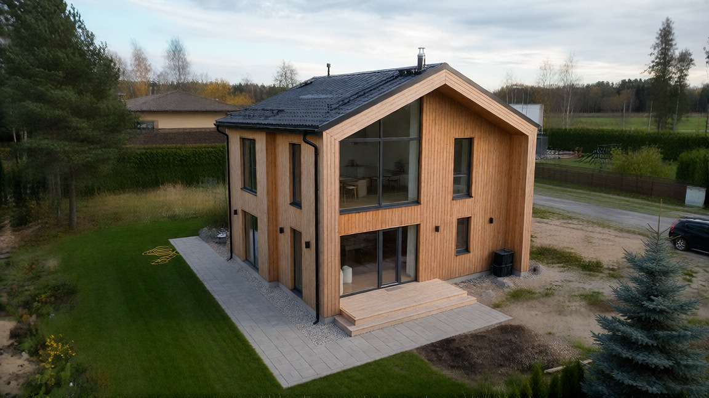 |

### B — MOSS box inpaint (depth + colour control, edit confined to a box)

| | | |
|---|---|---|
| 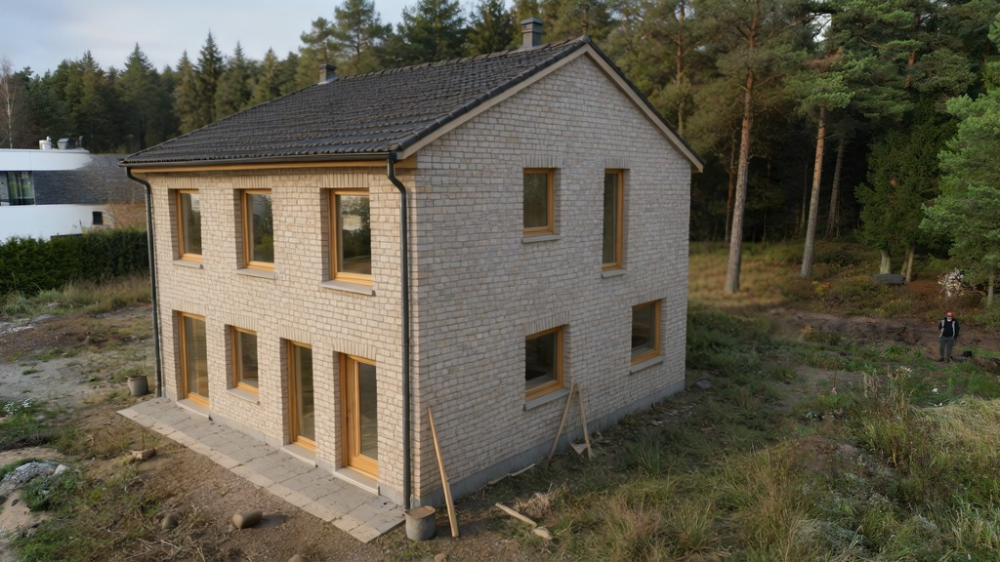 | 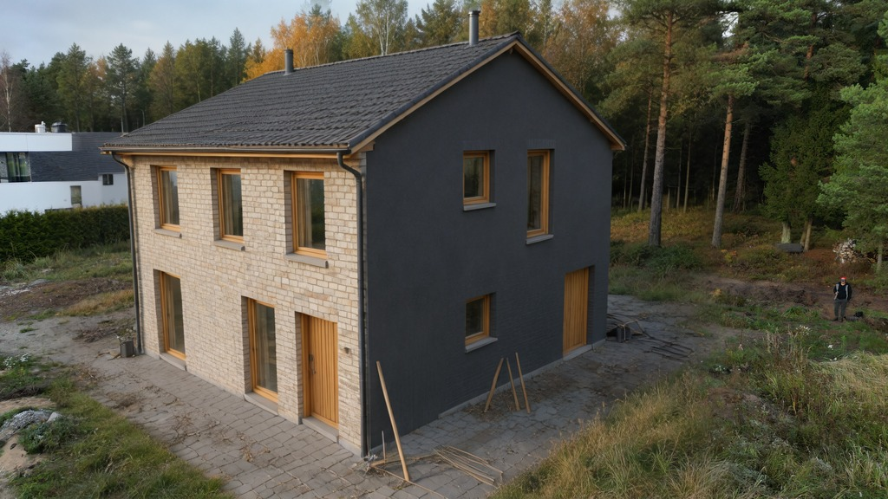 | 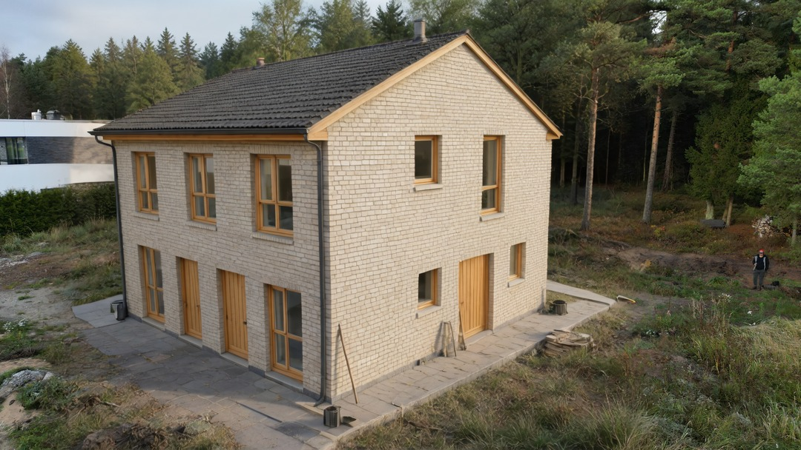 |
| pair 00003 · r 0.9958, **+2 flat tiles** | not a replay: **the camera moved**, and global depth `r` still said 0.99 | an earlier graph version: yellow brick, timber surrounds |

### C — Qwen-Image mask inpaint (edit stitched back)

Measured rows are small crops around the mask; the style variety of this method came from the
full-frame version of the same graph:

| | | | |
|---|---|---|---|
| 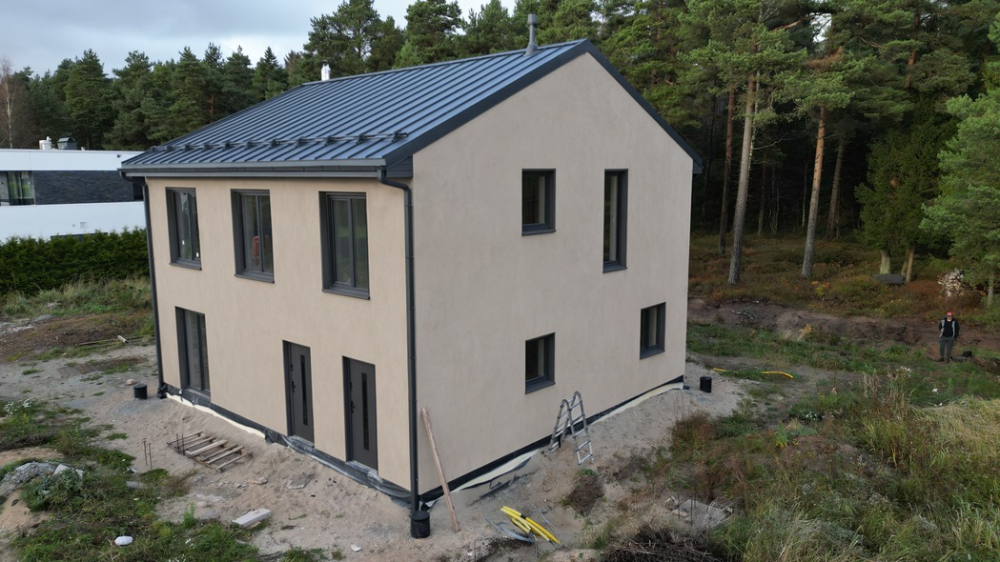 | 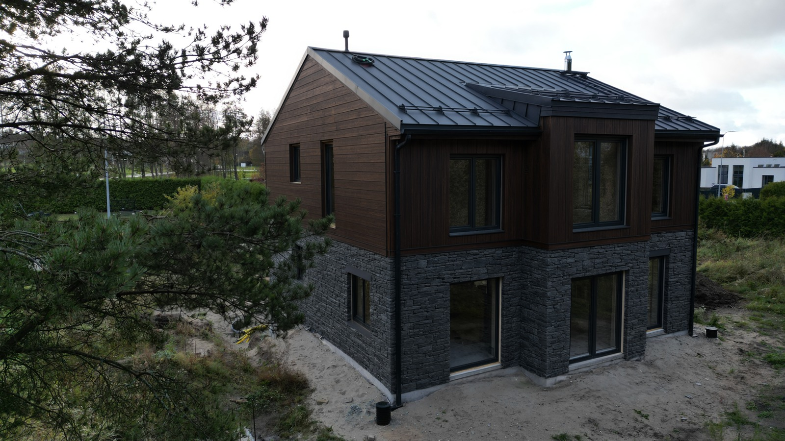 | 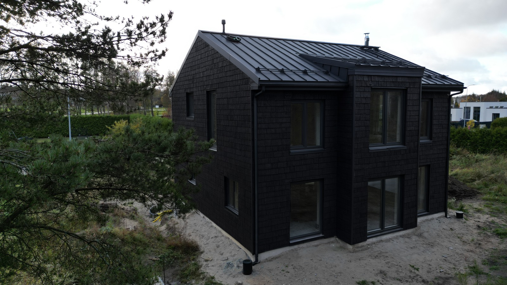 | 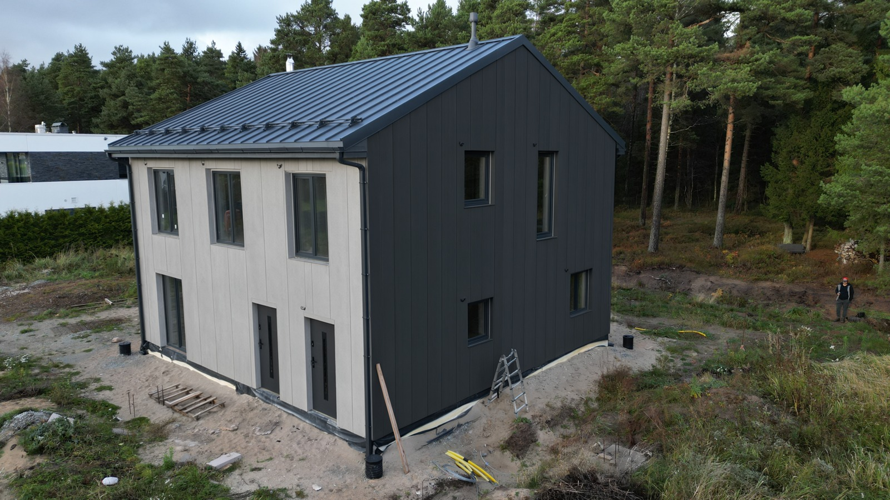 |
| pair 00001 · r 0.9996 (outside the mask: identical by construction) | slate stone + larch, "alpine chalet" | charred wood, shou sugi ban | light grey micro-cement panels, dark gables |

### D — a video made from two of these renders (MiniMax H3, not measured)

The same Qwen graph's style renders were used as the **first and last frames** of a shot, and a
frame-to-video model was asked to connect them with one smooth drone glide along the façade:

| first frame (the C row "charred wood + timber accents", `qwen21_inpaint_00015.png`) | last frame (a shou-sugi-ban+timber variant between the 00013/00015 rows, `qwen21_inpaint_00014.png`) |
|---|---|
|  | 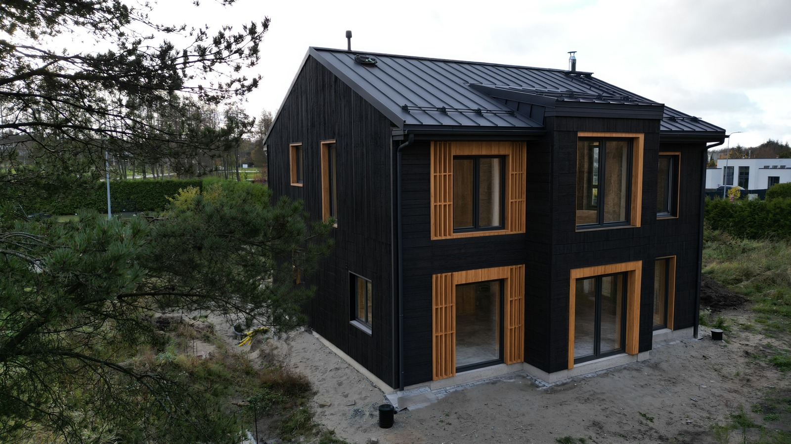 |

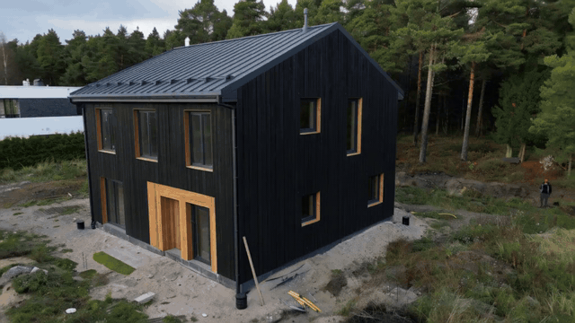

<sub>The final video as an autoplaying GIF preview (640 px, 12 fps, no sound). The actual file a run
wrote is <a href="docs/gallery/video/video_03.mp4">docs/gallery/video/video_03.mp4</a> —
1024×576, 24 fps, 5.17 s, 124 frames, with sound (the graph has its own audio VAE).</sub>

What generated it: [`workflows/MMH3.json`](workflows/MMH3.json) — **MiniMax H3 FL2V**
(first+last-frame-to-video, int8 pruned checkpoint, Qwen3-VL text encoder, video + audio VAEs) run in
ComfyUI on 04.11 19:01: seed 4 fixed, 6 steps, cfg 1.0, `res_multistep`. The camera path, the "no
warping, no morphing, rigid geometry" requirement and a soundscape (drone hum + minimal cello/piano)
were asked in words — there is **no depth signal and no mask** in this graph, so the video is not a
measured row: it is the first output of the next-steps item 6 (the video branch), not part of the A/B/C
comparison.

Two honest caveats, recorded in [`docs/gallery/MANIFEST.md`](docs/gallery/MANIFEST.md) rather than
hidden: the prompt text aligns the two pictures at 0.00 s and 15.08 s of "the target video" while the
duration widget said 5 s — the saved file is 5.17 s; and the ComfyUI folder carries the names
`qwen21_inpaint_00014/00015.png` twice by date (02.11 and 04.11) with identical bytes, so the frames'
provenance is pinned by the byte-identical repo copies above, not by their filenames.

Every image above is the actual file a run wrote. Where it came from — original filename, timestamp,
native size, seed, steps/cfg, and the prompt that was asked — is in
[`docs/gallery/MANIFEST.md`](docs/gallery/MANIFEST.md); the full prompt text of each run is in
[`docs/gallery/prompts.json`](docs/gallery/prompts.json).

## 4. The two metrics, and what they caught

Full definitions, the nine rows and the calibration controls: **[docs/metrics.md](docs/metrics.md)**.
Summary:

**Metric 1 — geometry.** Each graph saves a depth map of its own input and of its own result
(`DepthAnythingV2`). Pearson `r` between them, plus a **probe** of the same number after nudging one map
by 1% and 4% of the width, so every row is judged against its own scale and not against a constant.

| method | r | own 1% probe | edges r | pixels off | flat tiles Δ |
|---|---|---|---|---|---|
| A Krea2 edit | 0.9967 / 0.9913 / **0.3326** | 0.99 | 0.68 / 0.56 / 0.13 | 0.31% / 0.78% / 51.4% | +0 |
| B MOSS box | 0.9958 / 0.9947 | 0.9894 | 0.65 / 0.60 | 0.31% / 0.38% | **+2 of 48** |
| C Qwen mask | 0.9996 / 0.9993 | 0.9895 | **0.98** | 0.01% | +0 |

**Metric 2 — the finish.** Inside a declared region: Earth-Mover distance between colour histograms
(hue on the circle, sat/value as 1-D Wasserstein), a surface-detail ratio (gradient energy result ÷
reference), a worst-decile tile ratio, and a layout correlation with an alignment search that reports how
far the camera moved. Every change is quoted as a multiple of **that method's own run-to-run floor**.

| method | colour change | its own floor | detail ratio | worst tiles | layout corr |
|---|---|---|---|---|---|
| A Krea2 | 0.1208 | 0.00445 (same seed!) → **27×** | **0.773** | 0.54 | 0.825 |
| B MOSS | 0.1315 | **0.0** (byte-identical replays) | 0.952 | 0.61 | 0.752 |
| C Qwen (full-frame variant) | 0.0979 | not measurable yet | **1.18** | 0.96 | 0.900 |

Six controls calibrate the scale (same file twice = 0; a 1% nudge moves layout, not colour; an upside-down
photo keeps its colour statistics and dies on layout; a grey block reads as "detail gone"; a *different*
house of the same flight has to move the numbers or the region measures nothing). They are in
`docs/metrics/appearance/control_*.json`.

### What I actually learned

1. **Geometry and finish are different measurements.** All three methods held the house (r ≥ 0.99) while
   a human saw three different façades — the depth map of a flat wall does not care what colour it is.
   A pipeline judged by metric 1 alone would have reported three identical successes.
2. **A global correlation is not a viewpoint test.** Metric 1 gave `r = 0.9947` to a run that moved the
   camera closer and to a different angle. `edges r`, the tile grid, the layout correlation and my own
   eyes all caught it. The global number is a "same house, roughly the same place" test — nothing more.
3. **Reproducibility is a property of the method, and it is measurable.** MOSS replays byte-identical
   (floor exactly 0); Krea2 does not reproduce at all at a fixed seed (floor 0.0045, and 27× above that
   floor is a real change); Qwen is reproducible inside its mask and un-runnable headless outside it.
   Variance is part of the result, not an error to hide.
4. **Metric 2 found the failure metric 1 can't name**: Krea2's detail ratio is **0.77** with its worst
   decile at 0.54 — the finish was painted on flat. MOSS kept the surface (0.95) but produced two flat
   tiles; Qwen invented a little extra detail (1.18) and kept the layout best (0.90).
5. **The region is the weak point of metric 2.** Today it is the MOSS graph's leftover demo box: 59% of
   the frame, sky and lawn and a neighbour's roof included. Until a hand-drawn façade polygon replaces
   it, a global light change moves these numbers as much as a new façade does. So the finish numbers are
   comparative, not a certificate. The same weakness one level down: for the Qwen row the mask that was
   edited **was never saved** (the graph still stores three demo touches named *car*, *chair*, *table*, which
   cannot explain an edit of the whole façade, so they are stale state). All four appearance rows' images are
   in `docs/gallery/` so a reader can look for themselves.
6. **A widget is not what ran.** The MOSS graph's own size widgets say 1024×1024 while it generated
   1024×576, because with `resolution_source` off and an image linked into `AspectRatioSimplifier` the
   node takes the image's aspect and ignores `custom_width/custom_height`. The saved file's size is the
   only record worth trusting.

Cost on a 12 GB card (RTX 5070, everything fp8/bf16, `nvidia-smi` sampled from outside ComfyUI): the
five headless records are in `docs/metrics/run_*.json` — Krea2 61.5 s cold / **4.2 s warm**, MOSS 49–52 s
(peak 11.3 GB, the closest to filling the card), Qwen 86.8 s of queue ending in a failed run with no
output. Not a ranking yet; § 3 of `docs/metrics.md` says exactly what would be needed to make one.

## 5. Next, in order of what it would buy the reader

1. **A real façade polygon** as a project input (drawn once, stored as a mask, its provenance stated) —
   without it every appearance number stays qualified.
2. **3 seeds per method, same stated finish, card from a defined state** (`--cold`): turn one row per
   method into a comparison with variance instead of three anecdotes.
3. **Make C replayable headless**: save `MaskByTouch`'s own `MASK` output to a file and load it instead
   of touching the image in the browser. That removes the only un-measurable cost row.
4. **Declare the Qwen crop** (or make that graph save the stitched full frame) so its measured rows can
   be measured by metric 2 as well.
5. **A fourth graph that never ran**: the Krea2 **depth Control LoRA** (`krea2_depth_control_lora`,
   installed on 25.10 and never used — the A graph here went through the identity-edit LoRA with no
   control). It is the cleanest test of "control the geometry with a control signal instead of with
   prompt words", and its negative result would be just as publishable.
6. Then the video/VR branch (UE5 turntable → image-to-video) and a small demo. First step taken on
   04.11: `workflows/MMH3.json` (MiniMax H3, first+last frame → 5 s video) produced
   `docs/gallery/video/video_03.mp4` from two Qwen-inpaint renders of the house. It is unmeasured (no
   depth/compare nodes in that graph) and the UE5 turntable side is still untouched.

**And before this is published** (decisions, not engineering): rename the folder and make it the repo —
nothing in the repo depends on the directory name, but the rename has to happen while no shell has it as
its working directory; re-read the anonymisation note in `source/3d-datasmith/README.md` and the Krea 2
Community License line in § 8; cut a one-page version of this file for the application itself (the
question, `docs/gallery/compare.jpg`, the finding about the blind metric, the two summary tables).

## 6. The 3D part

`source/3d-datasmith/` holds the house as a **Datasmith export from ArchiCAD 29** (184 static meshes,
anonymised: address, companies and architect name removed — see its README). It was built for a UE5
visualization and a VR walkthrough of this same house, and it is in this repo as evidence of the 3D side
of the work, **not as an input to any measured run above**: none of the three graphs used it. The
original idea was to feed white-box renders of it into the same graphs; the project was re-scoped to the
photo-first comparison that could actually be measured, and that decision is recorded in
[PROGRESS.md](PROGRESS.md) rather than hidden.

## 7. Repo map

```
README.md                    this file: the question, the three methods, the results, what they mean
docs/metrics.md              both metrics: definitions, the rows, the controls, what they cannot see
docs/metrics/                raw machine-readable data (measurements.json, appearance/*.json, run_*.json);
                             appearance/inputs/ keeps the one control input that lived outside the repo
docs/gallery/                the images + one video + MANIFEST.md (file provenance) + prompts.json + compare.jpg
workflows/                   the three measured graphs + MMH3.json (video, unmeasured) + _api/ (API format) + manifest.json (conditions)
source/photos/               the input photos (full-frame ones stay out of git; the repo has 2048px copies)
source/3d-datasmith/         ArchiCAD→Datasmith house model — a skills showcase, unused by the runs
PROJECT.md · PROGRESS.md     the task as defined, and the session log of how it got re-scoped
```

## 8. Run it yourself

```
# ComfyUI 0.43.2 at J:/AI/ComfyUI-Easy-Install/ComfyUI
# open workflows/<graph>.json in the UI, set LoadImage to DJI_0021.JPG, run
# or post workflows/_api/<graph>.api.json to POST /prompt (A and B only — C needs a browser touch)
```

Models these graphs load, by exact filename (they are community quantizations, not official releases):

| role | file |
|---|---|
| UNet, graph A | `models/diffusion_models/Krea 2/kreavantisMASTERFP8_v10.safetensors` |
| text encoder A | `models/text_encoders/QWEN/qwen3vl_4b_fp8_scaled.safetensors` (`type: krea2`) |
| VAE A | `models/vae/qwen_image_vae.safetensors` |
| LoRA A (image-edit) | `models/loras/Krea2/krea2_identity_edit_v1_2.safetensors` |
| base, graph B | `moss_image_sft_bf16.safetensors` via the `LCOptimizer` node ("MOSS Image (SFT)") |
| control, graph B | `models/controlnet/MOSS/moss-color-depth-control.safetensors` (colour 0→0, depth 0→0.5) |
| UNet, graph C | `models/diffusion_models/QWEN/qwenImage21_bf16.safetensors` |
| text encoder C | `models/text_encoders/QWEN/qwen3vl_8b_fp8_scaled.safetensors` |
| VAE C | `models/vae/qwen_image_2.1_vae_bf16.safetensors` |
| mask model C | `models/checkpoints/sam3.1_multiplex_fp16.safetensors` |
| depth in both A/B/C measurement nodes | `depth_anything_v2_vits.pth`, resolution 1024 |

Nodes: `comfyui-krea2edit` / `comfyui-krea2-controlnet`, LC (ComfyUI_LC123_nodes, MOSS + layout boxes),
`ausboss-nodes` (Qwen mask-by-touch), `comfyui_controlnet_aux` (Depth Anything V2).
Custom nodes are free to run, **but the Krea 2 weights and the Krea2 LoRAs are under the Krea 2 Community
License, not MIT** — declared here before anything is published.

Hardware of every measurement: RTX 5070 12 GB, Ryzen 7 5700X, 64 GB RAM. 12 GB is the point: the fp8
checkpoints do not stay fully resident, ComfyUI's lowvram/offload path is the real configuration, and the
peak numbers above are reported with the free VRAM each run started from.
